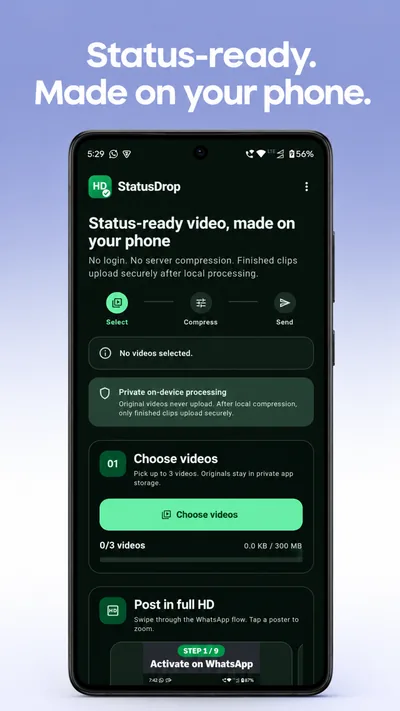
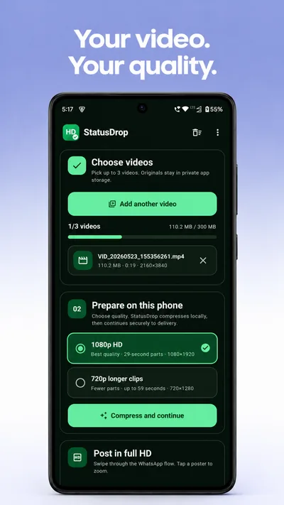
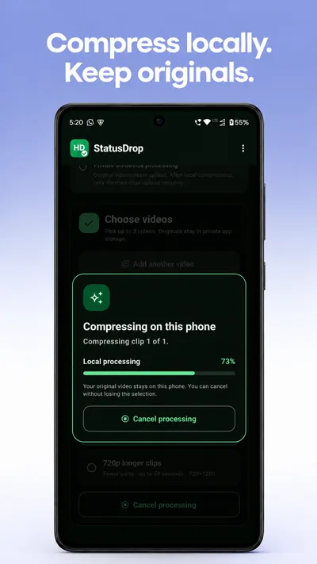
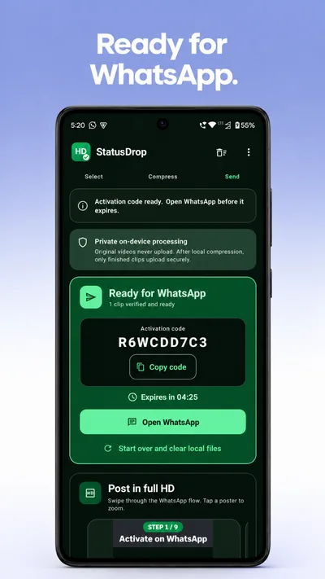

<div align="center">


# StatusDrop

**HD WhatsApp Status videos, prepared on your phone.**

StatusDrop is a free Android app that compresses and splits your videos on the phone into Status-ready HD clips, then delivers them to your own WhatsApp so they post without the usual blur.

<a href="https://play.google.com/store/apps/details?id=com.wastatusvideo.statusdrop"></a>

[](https://github.com/Shamanthnp1/WAstatus/releases/latest)
[](https://play.google.com/store/apps/details?id=com.wastatusvideo.statusdrop)
[](mobile/statusdrop_app)
[](mobile/statusdrop_app/LICENSE)
[](LICENSE)

[Website](https://www.wastatusvideo.com) · [Privacy policy](https://www.wastatusvideo.com/privacy.html) · [Releases](https://github.com/Shamanthnp1/WAstatus/releases) · [Self-hosting](SELF_HOSTING.md)

<br>






</div>

## Why StatusDrop?

A sharp video from your phone often looks soft and blurry once it's on WhatsApp Status, because WhatsApp compresses it again when you post. Long videos are a second problem: Status only takes short clips under a size limit, so you end up trimming them into parts by hand.

StatusDrop handles both:

- **It prepares each video so WhatsApp has less reason to compress it again.** Clips are re-encoded to a profile that kept its quality in testing: 1080×1920 H.264 at about 30 fps (60 fps videos got re-encoded), under WhatsApp's roughly 16 MB limit.
- **It splits long videos for you** into ready-to-post parts.
- **It sends the clips to your own WhatsApp chat.** In testing, a clip received in a chat and then posted with the [steps below](#post-in-full-hd) stayed sharp, while the same file uploaded from the gallery or forwarded from another phone came out blurry.

It's for anyone who posts videos to Status: people sharing with friends and family, creators, and small shops that use Status for updates.

**Why an app?** StatusDrop started as a website that compressed videos on a server. That was expensive to run, so the work moved onto your phone. That keeps StatusDrop free, and your original videos never leave the phone.

## Features

- **Compresses on your phone.** FFmpeg with x264 runs locally; your original videos are never uploaded.
- **Two quality profiles.** 1080×1920 HD in parts up to 29 seconds, or 720×1280 in longer parts up to 59 seconds.
- **Splits long videos automatically** into Status-ready parts and keeps each under WhatsApp's size limit.
- **Delivers to your own WhatsApp.** Tap *Open WhatsApp*, send the prefilled code, and the clips arrive in that chat.
- **Private by design.** No account or login, no ads, no analytics SDK, and no broad photo or storage permission; videos are picked with Android's system picker.
- **Built-in 9-step guide** for posting in full HD, plus an accessible light and dark interface.
- **Open source.** The app and the backend are both in this repository.

## How it works

```text
Android app (Flutter + Kotlin)
  pick up to 3 videos → FFmpegKit/x264 compresses and splits them on the phone
        │  finished clips only, over HTTPS
        ▼
Backend (Node.js / Express in Docker on Azure App Service) ──► Cloudflare R2
  checks size, SHA-256, H.264/AAC, resolution and duration      short-lived storage
  returns a 9-character activation code and a WhatsApp link
        │  you send the code from WhatsApp
        ▼
WhatsApp linked devices (Baileys, one or two numbers)
  send the clips back to that same chat, then delete them from R2
```

The website at [wastatusvideo.com](https://www.wastatusvideo.com) is a static page on Vercel with the Play Store link, the posting guide and the privacy policy. The old web compressor was retired in October 2026; its API routes now answer `410 Gone`.

## Post in full HD

Forwarding the bot's message straight to Status makes WhatsApp re-compress it. This sequence kept full quality in testing, and the app walks you through it:

1. In the chat with StatusDrop, open the video and tap **Download**.
2. Send the saved video into any chat (**Message yourself** works) with **📎 → Gallery**, choosing **HD** in the preview. Add your caption here.
3. On that **new copy**, tap **Forward → My Status** and post it.
4. Don't edit or trim the video in WhatsApp.

<details>
<summary>Why these steps? (manual test notes)</summary>

These were recorded during development from a small set of manual tests. File sizes are rounded and device and app versions weren't recorded, so treat this as practical evidence, not a guarantee.

| Path tested | Result |
|---|---|
| StatusDrop delivery (9.3 MB) → save → Gallery resend in HD → forward the new copy | Status stayed about 9.3 MB and looked sharp |
| Same file moved to the phone with Quick Share → Gallery resend in HD → forward | Status became about 4.0 MB and looked blurry |
| Bot media forwarded to another phone, then resent and posted there | Smaller copy; Status stayed degraded |
| Original bot message forwarded directly to Status | WhatsApp re-encoded it; quality dropped |

Direct delivery and the Gallery resend both mattered. WhatsApp doesn't document why, and it can change this behaviour at any time.

</details>

## Privacy

- Original videos stay in the app's private storage on your phone.
- Only the finished clips are uploaded. The server checks them, keeps them briefly in Cloudflare R2, and deletes them after delivery or when the 5-minute activation code expires.
- The server sees the WhatsApp account that sends the code (to reply to it), IP addresses for rate limiting, and technical logs.

Full details are in the [privacy policy](https://www.wastatusvideo.com/privacy.html).

## Repository layout

```text
mobile/statusdrop_app/   Android app: Flutter UI, Kotlin FFmpeg pipeline (GPL-3.0)
server.js                Express API, mobile upload routes, WhatsApp delivery
src/server/              Upload checks, WhatsApp lines, cleanup, message guards
public/                  Website on Vercel: landing page and privacy policy
test/                    Backend test suite (Node's test runner)
Dockerfile               Backend image (Node 24)
.github/workflows/       Backend deploy to Azure, GitHub releases on version tags
```

Some modules from the retired web compressor (rendering, editor, music) are still in the repository; their routes are disabled.

## Build and run

- **Android app:** build steps, limits and toolchain are in [mobile/statusdrop_app/README.md](mobile/statusdrop_app/README.md).
- **Backend:** environment variables, linking WhatsApp and deployment are in [SELF_HOSTING.md](SELF_HOSTING.md).
- **Tests:** `npm ci && npm test` runs the backend suite.

## Releases

Each app version is published on Google Play and as a [GitHub release](https://github.com/Shamanthnp1/WAstatus/releases) with its notes and matching source code. Pushing a tag such as `v1.0.1` that matches the version in `mobile/statusdrop_app/pubspec.yaml` creates the release automatically.

## Contributing

Issues and pull requests are welcome. Please run `npm test` for backend changes, and keep claims about video quality backed by testing.

## License

- **Android app** (`mobile/statusdrop_app/`): [GPL-3.0](mobile/statusdrop_app/LICENSE), because it bundles FFmpegKit with x264. See [third-party notices](mobile/statusdrop_app/THIRD_PARTY_NOTICES.md).
- **Backend and website:** [AGPL-3.0-or-later](LICENSE).

## Disclaimer

StatusDrop is independent and is not affiliated with, endorsed by, or sponsored by WhatsApp LLC or Meta Platforms, Inc. WhatsApp is a trademark of WhatsApp LLC. Delivery uses the unofficial Baileys library through linked devices, so WhatsApp can change or restrict it without notice.
